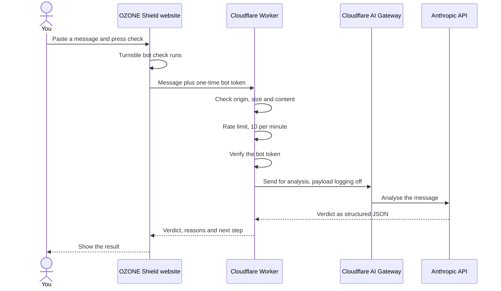
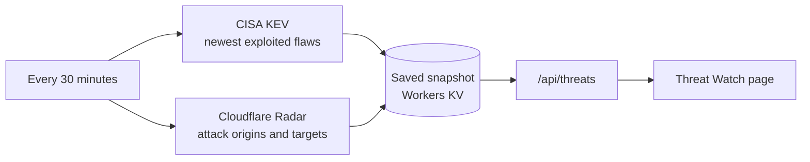
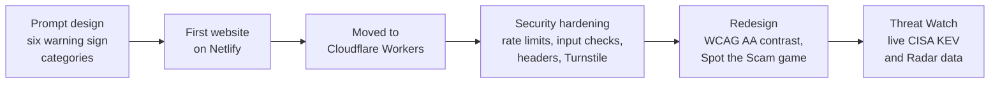

<div align="center">


[](https://ozone-shield.bbaranda055.workers.dev)
[](https://workers.cloudflare.com)

</div>

## Why I built this

Scam messages arrive on every channel now: email, text, WhatsApp, and more and more often as printed letters. The advice about them is spread across bank websites, government pages and news articles. Very little of it helps in the thirty seconds when someone is standing in their kitchen, wondering whether that text about a missed parcel is real.

Most people have good judgement. What they're missing is a quick, free second opinion at the moment they need one. So I built one.

You paste in the message, and OZONE Shield tells you whether it looks like a scam, why, and what to do next. There's no account to create, nothing to download and no technical knowledge needed.

**Try it here:** [ozone-shield.bbaranda055.workers.dev](https://ozone-shield.bbaranda055.workers.dev)

> **Please read this first.** OZONE Shield gives you guidance to help you decide. It can't guarantee anything. It reads the words of a message and points out warning signs, but it can't check who really sent it, whether a link is live, or what your situation is. A **SAFE** result means it found no obvious scam signs in the text, and that's all it means. Please don't rely on it alone for anything involving your money, your accounts or your identity. If something feels wrong, contact the organisation directly using a number you already have, never one from the message itself.

## What you get back

| Verdict | What it means | What to do |
|---|---|---|
| **SAFE** | No clear scam signs in the text | Carry on with your usual care, and keep the note above in mind |
| **SUSPICIOUS** | One to three warning signs | You'll be told exactly what to check before you reply |
| **SCAM** | Several strong warning signs | Don't click, call back or reply, and report it |
| **INVALID** | The text wasn't a real message | Paste the actual message and try again |

Every result also shows a confidence score from 0 to 100%, a severity of low, medium or critical, up to three reasons taken from the message itself, and one clear next step written for someone who isn't technical.

### Reporting a scam in the UK

Report Fraud replaced Action Fraud as the UK's official service for reporting fraud and cyber crime on 4 December 2025.

| Where you are | How to report |
|---|---|
| England, Wales and Northern Ireland | [reportfraud.police.uk](https://www.reportfraud.police.uk) or call 0300 123 2040 |
| Scotland | Police Scotland on 101 |

If you've lost money or think your bank account is at risk, call your bank straight away. Dialling **159** connects you safely to your bank, and it works for more than 99% of UK retail bank current accounts ([Stop Scams UK](https://stopscamsuk.org.uk/our-programmes/159-phone-number/)).

## How a check works

When you press the button, your message goes on a short journey. Each step has a job, and most of them are about keeping the service safe and keeping your data out of places it doesn't need to be.



It's built from plain HTML, CSS and JavaScript, with no framework and no build step, served by Cloudflare Workers. The font, Atkinson Hyperlegible Next, is hosted on the site itself. The backend Worker is called `ozone-analyse` and is explained in [`api/README.md`](api/README.md). It uses Claude (`claude-sonnet-4-6`) through Cloudflare AI Gateway, and every push to `main` deploys automatically.

### Threat Watch

The [Threat Watch page](https://ozone-shield.bbaranda055.workers.dev/live/) shows which software flaws are being exploited right now and where web attacks are coming from. Visitors never contact the data sources directly. A scheduled job collects the data and the page reads a saved copy.



If one source fails, the last good data stays on the page with its own timestamp, so you can always see how fresh it is. Radar needs a read-only API token saved as the `RADAR_TOKEN` secret. Without it, the page shows the vulnerability data and says plainly that attack data isn't connected. Radar data is licensed CC BY-NC 4.0 and credited on the page.

## Keeping it secure

| Control | How it's done |
|---|---|
| API key | Stored as an encrypted Cloudflare Worker secret and checked for the right format before use. It never appears in the code or reaches the browser |
| Allowed origins | Requests are only accepted from the live site |
| Rate limiting | 10 requests a minute per client, using Cloudflare's rate limiter. IPv6 addresses are grouped by /64 so one device can't dodge the limit by switching addresses. If the limiter itself fails, requests are refused rather than let through |
| Bot protection | Cloudflare Turnstile, checked on the server, and the token has to have been issued for this site |
| Input cleaning | Null bytes and control characters are removed first |
| Message length | Between 10 and 4,000 characters |
| Request size | 16 KB at most |
| Content type | Only `application/json` is accepted |
| Timeout | Calls to the AI are cut off after 25 seconds |
| API headers | `nosniff`, framing blocked, `no-store` caching and no referrer |
| Website headers | Set in [`public/_headers`](public/_headers): a strict Content Security Policy with no inline scripts or styles, where Turnstile is the only outside code allowed and the game page allows none. Also HSTS, framing blocked, a Permissions Policy and cross-origin isolation |
| AI Gateway logs | Message text and verdicts are kept out of the gateway logs |
| Error messages | Internal details never reach the browser |
| Reporting a weakness | [`security.txt`](public/.well-known/security.txt), following RFC 9116 |

The tests run with `node --test api/test/*.test.mjs` and `node --test worker/test/threats.test.mjs`.

## Your privacy

People paste some of their most sensitive messages into a tool like this: bank letters, "Hi Mum" texts, fake hospital appointments. I've treated privacy as part of the design from the start. Here's exactly what happens to what you paste.

| What | Why | Where it goes |
|---|---|---|
| The message you paste | It's what gets checked | Sent to the Anthropic API through Cloudflare AI Gateway, with gateway logging of the content switched off. Anthropic deletes API inputs and outputs within 30 days unless they're flagged or the law requires otherwise, and doesn't train on them. Real scam messages often contain names, phone numbers or account references, so it may include personal data |
| Your IP address | Rate limiting only | Used as the key for Cloudflare's rate limiter and not stored by OZONE Shield. Under UK GDPR an IP address counts as personal data, and it's treated that way |
| Request details | Spotting errors and tracking cost | Logged through Cloudflare without the message content |

A few choices I made on purpose:

* There's no account, no sign-up and no tracking. The tool asks nothing about you.
* There are no analytics or advertising scripts. The only outside code on the site is the Turnstile bot check.
* All AI calls happen on the server, so the API key never reaches your browser.
* Responses are marked `no-store`, so verdicts aren't cached along the way.
* Nothing you paste is used for training, and the tool keeps no database of messages.

**Before you paste**, it's a good idea to replace card numbers, passwords, one-time codes and account numbers with `XXXX`. The warning signs are in the wording and structure of a message, so the result will be just as good and you'll have shared less.

**What's still being worked on.** A full data protection impact assessment is in progress, covering the data flows, lawful basis, retention and processor terms, written against the Information Commission's guidance. It will be published here. I'm also writing up how long AI Gateway keeps its metadata logs, so it's documented rather than assumed. The privacy notice is already live on the site.

## What it looks for

The AI is guided to look at six kinds of warning sign:

1. **Payment red flags**: gift cards, cryptocurrency, wire transfers, "safe account" requests and small delivery or customs fees.
2. **Pressure tactics**: urgency, fear, greed, pretending to be someone in authority, curiosity hooks, guilt and sympathy.
3. **Odd links and identities**: look-alike web addresses, swapped characters, senders who don't match who they claim to be, and shortened links.
4. **Language clues**: deliberate misspellings, patchy grammar, generic greetings and phrasing that doesn't sound right.
5. **Typical scam shapes**: requests for passwords or one-time codes, moving you to another app, offers that are too good to be true, and requests for remote access.
6. **UK scams**, which count for the most: "Hi Mum" WhatsApp fraud, safe account fraud, courier fraud, fake HMRC, DVLA, Royal Mail, Parcelforce and NHS messages, investment and crypto scams, romance scams and energy rebate scams.

## What's in the repository

```
ozone-shield/
├── public/                         The website, and the only folder that's served
│   ├── index.html                  Welcome page and the message checker
│   ├── scams/index.html            Scam map and UK fraud figures
│   ├── live/index.html             Threat Watch
│   ├── network/index.html          How the internet works
│   ├── help/index.html             Already paid? Steps and official checks
│   ├── about/index.html            How it works, privacy policy and terms
│   ├── spot-the-scam/index.html    Spot the Scam training game
│   ├── 404.html                    Page for unknown addresses
│   ├── css/, js/, fonts/           Styles, scripts and the font
│   ├── _headers                    Security headers for every page
│   └── .well-known/security.txt    How to report a weakness
├── api/                            The ozone-analyse Worker and its tests
├── worker/                         The website Worker, /api/threats and the 30 minute refresh
├── wrangler.jsonc                  Website Worker settings
└── README.md                       This file
```

## How it got here

I started this on my own laptop and it's grown one step at a time:



The first version ran on Netlify until its free credit ran out, which is how it ended up on Cloudflare Workers. The redesign brought the contrast up to WCAG AA with no axe-core violations, and every figure on the site is checked against its source. The Spot the Scam game keeps your progress only on your own device.

## What's next

* [ ] Finish the DPIA and publish it here
* [ ] Make the AI step tougher: defences against prompt injection, checked output and a proper test set
* [ ] A custom domain
* [ ] Checking suspicious links as well as text
* [ ] A browser extension, so you can right-click any message to check it
* [ ] A mobile app
* [ ] An API so other services can use OZONE Shield verdicts

## About me

I'm **Bhargav Baranda**. I hold an MSc in Information Security from Royal Holloway, University of London, and CompTIA Security+. OZONE Shield is a personal project that I built and run on my own, and it's free to use and always will be.

You can find me on [LinkedIn](https://linkedin.com/in/bhargav-baranda) and [YouTube](https://youtube.com/@Granger-Security), and the rest of my security work is in my [information security portfolio](https://github.com/Granger0007/Bhargav-Baranda-Portfolio).

<div align="center">

[](https://ozone-shield.bbaranda055.workers.dev)


</div>
